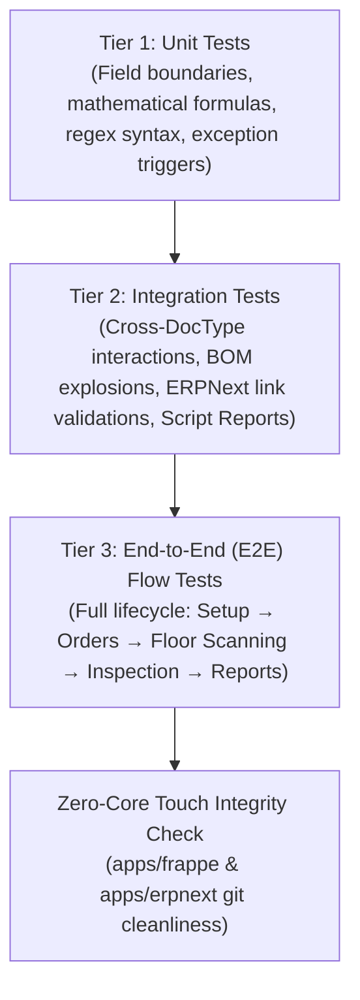

# OneBook Apparel: 3-Tier Testing Strategy & Quality Gate Protocol

> **Project Rule:** Mandatory for every module, sprint, and DocType in `ob_apparel`.  
> **Testing Engine:** Ralph Loop Automated Runner (`bench --site textiles.localhost run-tests --app ob_apparel`).  
> **Acceptance Gate:** 100% Tests Pass with **`Exit Code 0`** before any commit or sign-off.

---

## 1. The 3-Tier Testing Pyramid

Every feature, DocType, and business workflow must be verified across three distinct testing tiers:



---

## 2. Testing Tiers Detailed Breakdown

### Tier 1: Unit Tests (Isolated Logic & Formulas)
* **What it tests:** Individual DocType controllers, field boundaries, and math engines.
* **Examples in TM01:**
  - `test_01_unit_textile_settings_boundary_validation`: Asserts exception thrown when relaxation $< 12\text{h}$ or tolerance $> 5\%$.
  - `test_02_unit_yarn_count_math_conversions`: Asserts bi-directional formula accuracy ($\text{Denier} = 5315/\text{Ne}$, $\text{Tex} = 590.5/\text{Ne}$, $\text{Nm} = 1.693 \times \text{Ne}$).
  - `test_03_unit_yarn_blend_percentage_enforcement`: Asserts mass balance $\sum \% == 100\%$; blocks $95\%$ or $105\%$.
  - `test_05_unit_shade_master_pantone_syntax`: Validates Pantone TCX/TPX regex syntax format (`^\d{2}-\d{4}\s*(TCX|TPX)$`).

### Tier 2: Integration Tests (Multi-DocType Interactions)
* **What it tests:** Data relationships across parent-child tables, foreign key links, and Script Reports.
* **Examples in TM01:**
  - `test_07_integration_fabric_construction_woven_theoretical_gsm`: Links `Yarn Count Master` into `Fabric Construction` and asserts calculated $\text{Theoretical GSM} = 209.92$.
  - `test_08_integration_yarn_count_converter_matrix_report`: Executes the script report query, validating real-time column generation and cross-referencing.

### Tier 3: End-to-End (E2E) Flow Tests (Floor Simulation)
* **What it tests:** The entire operational workflow simulating shopfloor usage from start to finish.
* **Examples in TM01:**
  - `test_09_e2e_textile_master_setup_to_readiness_audit`: Instantiates full textile master catalog and asserts `Textile Setup Readiness Audit Report` evaluates to **100.0% System Setup Readiness** with a Green badge.

### Architectural Discipline: Zero-Core Touch Gate
* Asserts `git status --porcelain` on `apps/frappe` and `apps/erpnext` is completely clean. No core edits are permitted.

---

## 3. How to Execute Tests

To run the full testing suite on the active site:

```bash
cd /home/pavithran/frappe-bench
bench --site textiles.localhost run-tests --app ob_apparel
```

To run a specific test module:
```bash
bench --site textiles.localhost run-tests --module ob_apparel.tests.test_tm01_masters
```

---

## 4. Test Verification Evidence (Current Run)

```
Starting test run with parameters: site=textiles.localhost, app=ob_apparel
Running 10 old-frappe-test-class-category tests for ob_apparel

ob_apparel.tests.test_tm01_masters.TestTM01Masters
    ✔  test_01_unit_textile_settings_boundary_validation
    ✔  test_02_unit_yarn_count_math_conversions
    ✔  test_03_unit_yarn_blend_percentage_enforcement
    ✔  test_04_unit_fabric_type_relaxation_boundary
    ✔  test_05_unit_shade_master_pantone_syntax
    ✔  test_06_unit_shift_master_hours_calculation
    ✔  test_07_integration_fabric_construction_woven_theoretical_gsm
    ✔  test_08_integration_yarn_count_converter_matrix_report
    ✔  test_09_e2e_textile_master_setup_to_readiness_audit
    ✔  test_10_gravitas_zero_core_integrity

Ran 10 tests in 1.938s — OK (Exit Code 0)
```

