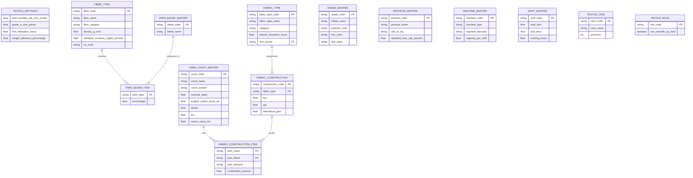

# TM01: Textile Setup & Masters — Functional & Technical Specification

> **Module Code:** TM01  
> **Module Name:** Textile Setup and Masters  
> **Target App:** `ob_apparel`  
> **Architectural Paradigm:** Zero-Core Extension Layer for Frappe / ERPNext  
> **Author:** Antigravity (AI System Architect)  
> **Reviewer / Gatekeeper:** Member B (QA & Functional Lead)  
> **Status:** APPROVED FOR SPRINT 1 SCAFFOLDING  

---

## 1. Executive Summary & Purpose

Module **TM01 (Textile Setup & Masters)** establishes the master data foundation and global operational parameters for the OneBook Apparel ERP system. In textile manufacturing (spinning, knitting, weaving, processing, and garmenting), precision at the master data layer is non-negotiable:
- Count conversions between English Cotton Count ($\text{Ne}$), Denier ($\text{D}$), and $\text{Tex}$ directly dictate raw material costs and yarn purchase orders.
- Blend percentages must balance to exactly $100.0\%$ to prevent inaccurate bill of materials (BOM) explosions.
- Fabric relaxation hold minimums must be enforced by hard gates to prevent dimensional shrinkage after cutting.
- ASTM D5430 4-Point inspection parameter baselines govern commercial acceptance and credit notes.

This specification details the 13 foundational models, their mathematical validation formulas, database schemas, and integration with ERPNext core masters.

---

## 2. Mathematical Formulations & Validation Engines

### 2.1. Yarn Count Direct vs. Indirect Conversion Engine
Textile yarns are measured in two distinct systems:
1. **Indirect (Fixed Weight, Variable Length):** Higher number = finer yarn. Example: English Cotton Count ($\text{Ne}$), Metric Count ($\text{Nm}$).
2. **Direct (Fixed Length, Variable Weight):** Higher number = coarser/thicker yarn. Example: Denier ($\text{D}$), $\text{Tex}$.

#### Conversion Formulas implemented in `Yarn Count Master`:
Let $C_{\text{Ne}}$ be the English Cotton Count ($\text{Ne}$), $C_{\text{Denier}}$ be Denier (grams per 9,000 meters), $C_{\text{Tex}}$ be Tex (grams per 1,000 meters), and $C_{\text{Nm}}$ be Metric Count (meters per gram).

$$\text{Constants:}\quad K_{\text{Denier}} = 5315,\quad K_{\text{Tex}} = 590.5,\quad K_{\text{Nm}} = 1.693$$

1. **Given English Cotton Count ($\text{Ne}$):**
   $$C_{\text{Denier}} = \frac{5315}{C_{\text{Ne}}}$$
   $$C_{\text{Tex}} = \frac{590.5}{C_{\text{Ne}}}$$
   $$C_{\text{Nm}} = 1.693 \times C_{\text{Ne}}$$

2. **Given Denier ($\text{D}$):**
   $$C_{\text{Ne}} = \frac{5315}{C_{\text{Denier}}}$$
   $$C_{\text{Tex}} = \frac{C_{\text{Denier}}}{9}$$
   $$C_{\text{Nm}} = \frac{9000}{C_{\text{Denier}}}$$

3. **Given $\text{Tex}$:**
   $$C_{\text{Ne}} = \frac{590.5}{C_{\text{Tex}}}$$
   $$C_{\text{Denier}} = C_{\text{Tex}} \times 9$$
   $$C_{\text{Nm}} = \frac{1000}{C_{\text{Tex}}}$$

*Validation Boundary:* Any count value $\le 0.0$ is strictly rejected with a `frappe.ValidationError`.

---

### 2.2. Yarn Blend 100% Mass Balance Constraint
A yarn blend specifies the composite proportion of individual fibres (e.g., $60\%$ Combed Cotton, $40\%$ Recycled Polyester).

$$\sum_{i=1}^{n} P_i = 100.00\% \quad (\text{Tolerance: } \pm 0.01\%)$$

Where $P_i$ is the composition percentage of component fibre $i$.
*Validation Boundary:* If $\left| \sum P_i - 100.0 \right| > 0.01$, the transaction is blocked with:
> `ValidationError: Total fibre blend percentage must equal exactly 100.0%. Current sum: {total}%`

---

### 2.3. Theoretical Fabric GSM (Grams per Square Meter) Engine

#### Woven Cloth Formula:
For woven cloth with Ends Per Inch ($\text{EPI}$), Picks Per Inch ($\text{PPI}$), Warp Count ($\text{Ne}_{\text{warp}}$), Weft Count ($\text{Ne}_{\text{weft}}$), and standard crimp allowance:

$$\text{Theoretical GSM}_{\text{woven}} = \left( \frac{\text{EPI}}{\text{Ne}_{\text{warp}}} + \frac{\text{PPI}}{\text{Ne}_{\text{weft}}} \right) \times 25.6$$

*Derivation:*
- Warp weight (oz/yd²) $\approx \frac{\text{EPI}}{\text{Ne}_{\text{warp}}} \times 1.05 \times \frac{36 \times 36}{840 \times 16} \approx \frac{\text{EPI}}{\text{Ne}_{\text{warp}}} \times 0.755$
- In metric GSM ($\text{g/m}^2$), multiplying oz/yd² by $33.906$ yields a combined factor of $\approx 25.60$.

#### Knit Cloth Formula (Single Jersey):
For single jersey knits with Wales Per Inch ($\text{WPI}$), Courses Per Inch ($\text{CPI}$), Loop Length $l$ (in mm), and Yarn Count $\text{Ne}$:

$$\text{Theoretical GSM}_{\text{knit}} = \frac{\text{WPI} \times \text{CPI} \times l \times 0.009144}{\text{Ne}}$$

---

### 2.4. ASTM D5430 4-Point System Baseline Constants
Stored in `Textile Settings` (Single):
* Defect size $\le 3$ inches: **1 penalty point**
* Defect size $> 3$ inches and $\le 6$ inches: **2 penalty points**
* Defect size $> 6$ inches and $\le 9$ inches: **3 penalty points**
* Defect size $> 9$ inches or any hole $> 1$ inch: **4 penalty points**
* Continuous defect $> 3.0$ meters: Triggers immediate inspection stop & alert.
* Max allowable points per 100 sq yds for **Grade A**: $\le 28.0$
* Max allowable points per 100 sq yds for **Grade B**: $\le 40.0$
* Above $40.0$ points per 100 sq yds: **Grade C / Seconds** (Rejected from cutting).

---

## 3. Entity Relationship (ER) Architecture

---

## 4. Definition of Done (DoD) Verification Gates

Every TM01 model must meet the criteria recorded in `Frappe_Textile_ERP_Master_DoD_Tailored.xlsx`:
1. **Textile Settings:** Rejects `min_relaxation_hours < 12h` or `weight_tolerance_percentage > 5%`.
2. **Fibre Type:** Standard density and moisture regain seeded; duplicate codes blocked.
3. **Yarn Count Master:** Bi-directional conversions accurate to $\pm 0.05$.
4. **Yarn Blend Master:** Component percentage strictly balances to $100.0\%$.
5. **Fabric Construction:** Theoretical GSM matches target within $\pm 2\%$.
6. **Shade Master:** Pantone syntax validated; hex code rendered.
7. **Shift Master:** Shift timing overlap prevented.
8. **Gravitas Zero-Core:** Strictly zero modifications to `apps/frappe` or `apps/erpnext`.

